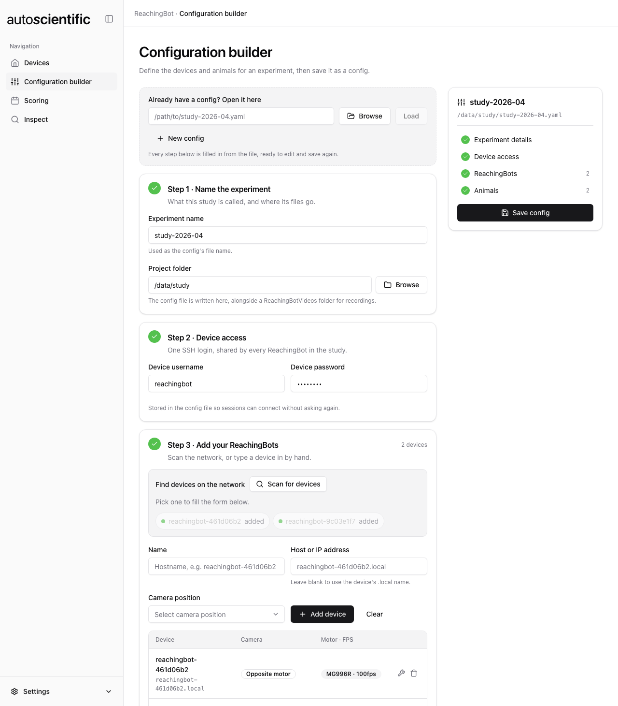
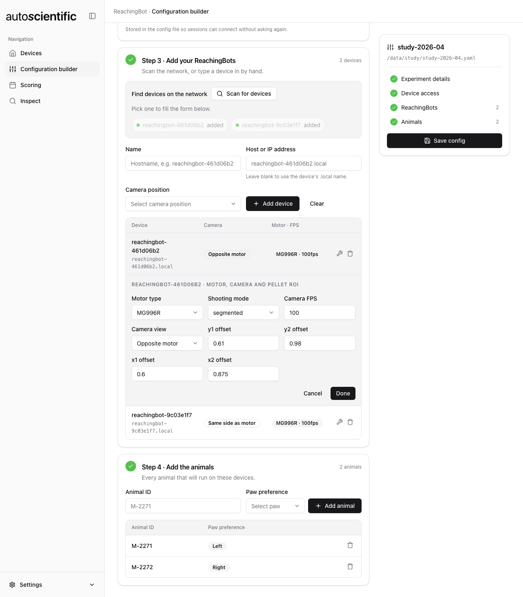

# Configuration builder

The **Configuration builder** writes the experiment YAML that the
[Devices](devices.md) view then runs from. It produces exactly the same file
format as the legacy Device Manager, so configs are interchangeable between the
two applications — see [Experiment config file](../reference/config-file.md).

The view is four numbered steps, in the order the work happens, beside a summary
rail on the right that shows the file being built, ticks each step off as it is
completed, and holds the **Save config** button.

To edit an existing study instead of starting fresh, put its path in the field
at the top of the page (or use the browse button) and click **Load**; the four
steps are filled in from it. Re-saving keeps any per-device settings that were
already in the file rather than resetting them to defaults.

The app remembers the config you last saved or loaded and reopens on it the next
time it starts, in every view. If that file has since been moved or deleted, the
app quietly forgets it and starts empty.

**New config** clears every step and unloads the current config from the whole
app, so you can start a fresh study. It asks first if anything unsaved would be
lost. The YAML file on disk is left as it is.

!!! note "The config is locked while a device is busy"
    While a session, the motor API server, servo calibration or the camera feed
    is running, **Load**, **New config** and **Save config** are disabled, and the
    page says what is running, with a link to the Devices view where you can stop
    it. Swapping the config reloads the fleet, which would leave whatever is
    running with no way to stop it from the app. You can still edit the form in
    the meantime.

<figure markdown>

<figcaption>All four steps done. The rail on the right names the file that will be written, ticks each step off, and only then lets the config save.</figcaption>
</figure>

## Walkthrough

One pass over the whole flow — from an empty builder to a saved config:

<figure markdown>
<video controls muted playsinline preload="none"
       poster="../../assets/app/config-builder-walkthrough-poster.jpg">
  <source src="../../assets/app/config-builder-walkthrough.mp4" type="video/mp4">
  Your browser does not support embedded video.
</video>
<figcaption>Naming the study, entering the device login, scanning for ReachingBots and adding two, adding the animals, saving, and opening the fleet in Devices.</figcaption>
</figure>

## Step 1 — Name the experiment

| Field | Notes |
| --- | --- |
| **Experiment name** | Becomes the filename, e.g. `study-2026-04` → `study-2026-04.yaml` |
| **Project folder** | Where the YAML is written. A `ReachingBotVideos` folder is created alongside it and becomes the config's video directory |

## Step 2 — Device access

The SSH username and password for the ReachingBots themselves. These are
supplied to you by email; if you do not have them, contact
[info@autoscientific.co.uk](mailto:info@autoscientific.co.uk).

One login is stored per config and applied to every device in it.

!!! note
    The password is written into the YAML in plain text, as Device Manager did.
    Treat the config file as a credential and keep it out of shared drives and
    version control.

## Step 3 — Add your ReachingBots

### Scanning

**Scan for devices** listens on the local network for about five seconds for
ReachingBots announcing themselves over mDNS, and lists each one it hears with
its IP address. Hover over an entry to see its model and serial number.
**Stop scan** ends the scan early. A device that is already in the config is
shown as **added** and cannot be picked again.

Each ReachingBot's hostname comes from its serial number, in the form
`reachingbot-` followed by eight characters, e.g. `reachingbot-461d06b2`.
Clicking a found device fills that name into the form below it.

!!! note
    A device only shows up in a scan if its firmware announces itself on the
    network. If a device you know is switched on does not appear, add it by
    hand instead.

Earlier versions of the app could rename a device to `ReachingBot1`–`10` from
here. That option has gone: hostnames now follow the serial number, which is how
each device is identified.

### Adding a device by hand

| Field | Notes |
| --- | --- |
| **Name** | The device hostname, e.g. `reachingbot-461d06b2` |
| **Host or IP address** | Optional. Leave it blank to reach the device by its network name, `<name>.local` (the field shows this as you type). This keeps working if the device's IP address changes. Enter an IP address only if `.local` names do not work on your network |
| **Camera position** | `Opposite motor` (default) or `Same side as motor` |

Added devices appear in a table showing **Device**, **Camera** and
**Motor · FPS**.

### Per-device settings

Each row has a settings button that opens the rest of that device's
configuration. **This is the main difference from Device Manager**, which
hardcoded these values — here each device can differ, and can be changed at any
point.

| Setting | Default | Notes |
| --- | --- | --- |
| **Motor type** | `MG996R` | Or `MG90S` for the legacy motors. Sets the default servo positions for a device that has not been [calibrated](devices.md#servo-calibration) |
| **Shooting mode** | `segmented` | Or `continuous` — see [Video recording modes](../reference/video-recording-modes.md) |
| **Camera FPS** | `100` | Changing this with `continuous` mode is not recommended |
| **Camera view** | `Opposite motor` | Flips the frame when the camera is on the motor side |
| **`y1_offset`** | `0.61` | Pellet-detection ROI, top edge as a fraction of frame height |
| **`y2_offset`** | `0.98` | ROI bottom edge |
| **`x1_offset`** | `0.6` | ROI left edge as a fraction of frame width |
| **`x2_offset`** | `0.875` | ROI right edge |

<figure markdown>

<figcaption>Settings open on reachingbot-461d06b2. In Device Manager most of these were hardcoded; here they hang off the device that has them and can be changed at any point.</figcaption>
</figure>

See [Pellet detection](../reference/pellet-detection.md) for how to choose the
ROI, and the camera feed on the [Devices](devices.md#camera-feed) view for
checking it visually.

## Step 4 — Add the animals

| Field | Notes |
| --- | --- |
| **Animal ID** | Your identifier for the animal, e.g. `M-2271` |
| **Paw preference** | `To be determined` (default), `Left` or `Right` |

Animals are listed in a table and can be removed from it. Animal IDs added here
become the suggestions offered when starting a session on the
[Devices](devices.md) view.

## Saving

**Save config** writes `{project folder}/{experiment name}.yaml` and creates the
`ReachingBotVideos` directory next to it. The file is validated before it is
written, and the save is refused unless there is at least one device **and** at
least one animal.

Once saved, **Open in Devices** takes you straight to the fleet with that config
loaded. Saving also updates the Devices, Scoring and Inspect views, so they
always work from the latest version of the file.
