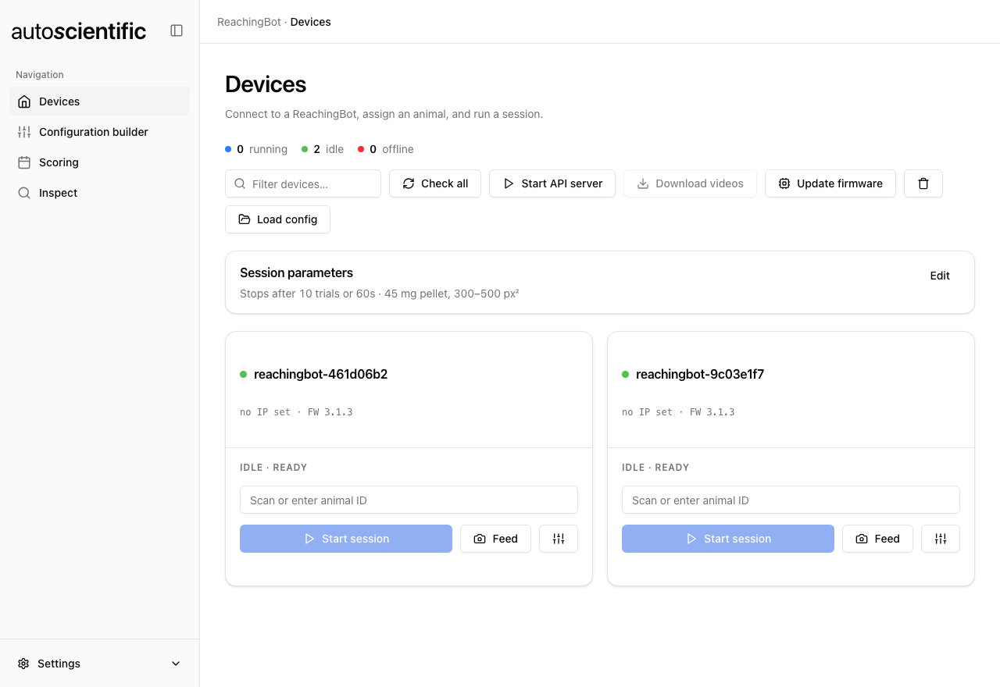
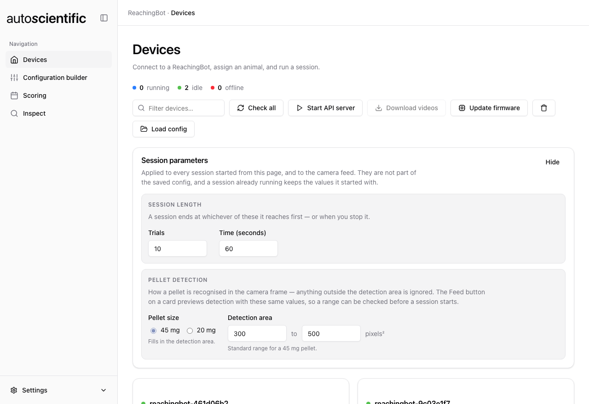
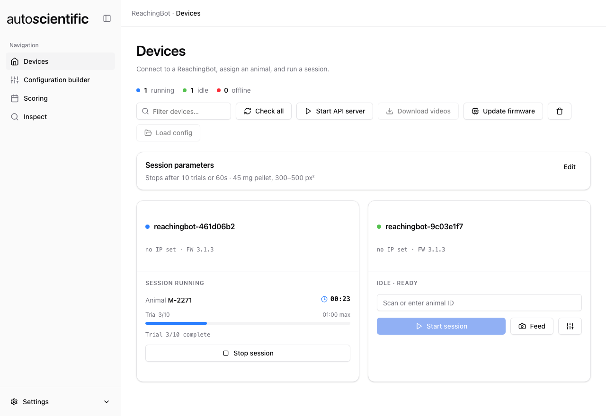

# Devices

The **Devices** view is the fleet: every ReachingBot in the loaded config, its
connection state, and the actions you run against it.

Open a config with **Load config** in the toolbar, or click **Open in Devices**
after saving one in the [Configuration builder](configuration-builder.md). The
app reopens on the config you last used, and checks the connection to every
device in it as soon as it loads, so the fleet is ready without any clicks.

Switching to another view does not stop anything here. Sessions, the API server
and the camera feed keep running, and each device keeps its status until you
come back.

<figure markdown>

<figcaption>Two devices loaded from a config and connected. The counts above the toolbar track the fleet; each card is one ReachingBot.</figcaption>
</figure>

## Fleet toolbar

Across the top: counts of **running**, **idle** and **offline** devices, a
filter box, and the fleet-wide actions.

| Action | What it does |
| --- | --- |
| **Check all** | Checks the connection to every device in the config again and updates its state. It does not look for new devices — use **Scan for devices** in the [Configuration builder](configuration-builder.md#scanning) for that |
| **Start API server** / **Stop API server** | Serves the [motor API](../reference/motor-api.md) on every connected device |
| **Download videos** | Pulls this session's videos off each connected device that has an animal assigned |
| **Update firmware** | Installs a firmware archive on every connected device |
| **Trash icon** | Deletes all videos and logs on every connected device |
| **Load config** | Opens a different experiment YAML |

## Device states

| On the card | Meaning |
| --- | --- |
| **Not checked** | Not checked yet — use **Connect** on the card, or **Check all** |
| **Connecting…** | Opening the connection |
| **Idle · ready** | Connected and ready to run a session |
| **Session running** | A session is in progress |
| **API server running** | Serving the motor API. Stop it before running sessions on this device |
| **Not connected** | The device didn't respond. Check it's powered and on the network, then **Retry connection** |

The counts above the toolbar summarise the same thing as **running**, **idle**
and **offline**.

Each card also shows the device's IP address (or `no IP set`) and its firmware
version once probed (`FW 1.0.0`, or `no firmware`).

## Session parameters

A panel above the fleet holds the parameters applied to **every** session
started from this page, and to the camera feed. It starts collapsed to a
one-line summary; click it to change the values. They are **not** part of the
saved config, and a session already running keeps the values it started with.

| Parameter | Default | Notes |
| --- | --- | --- |
| **Trials** | `10` | Maximum trials before the session ends |
| **Time (seconds)** | `60` | Maximum session length |
| **Detection area** | `300` to `500` pixels² | Smallest and largest pellet blob area. Presets are available for common 20 mg and 45 mg pellets |

<figure markdown>

<figcaption>The panel expanded. Collapsed, it summarises itself in one line, e.g. "Stops after 10 trials or 60s · 45 mg pellet, 300–500 px²".</figcaption>
</figure>

The through-beam sensor option has been removed from the app.

Whichever limit is reached first — trials or time — ends the session.

The pellet-detection ROI is **not** here: it is per-device and lives in the
config, because it depends on where each device's pellet sits in frame. See
[Pellet detection](../reference/pellet-detection.md).

## Running a session

1. Make sure the device reads **Idle · ready**. If it reads **Not checked** or
   **Not connected**, click **Connect** or **Retry connection**.
2. Enter the animal in **Scan or enter animal ID**. Animals from the config are
   offered as suggestions. **Start session** stays disabled until an animal is
   set.
3. Click **Start session**.

Before the session starts, the app checks the device's clock. A ReachingBot has
no battery-backed clock, so on a network without internet access it can boot
with the wrong time, and the device names its videos by that time. If the clock
is more than two seconds out, the app sets it from your computer's clock. If
that fails, the session still runs and the app shows a warning.

While it runs, the card shows the animal, elapsed time against the time limit,
and trial progress (`Trial 3/10`) as the device reports it, plus the most recent
line of device output.

<figure markdown>

<figcaption>A session running on ReachingBot1 — animal, elapsed time, trial progress and the latest line of device output — while ReachingBot2 stays idle and ready.</figcaption>
</figure>

**Stop session** ends it gracefully — the device is interrupted rather than
killed, so the session closes down and its videos are written out.

Sessions run per-device, so you can start several devices with different animals
and watch them side by side.

## Camera feed

**Feed** on an idle device opens the live camera preview, served by the device
itself. Use it to confirm pellet detection before a session: a good result is a
white circle tracking the pellet inside the white ROI rectangle, without
flickering.

The camera can take several seconds to start on the device. While it does, the
window reads **Starting the camera on the device…** and counts the seconds. If
the camera has not answered within 30 seconds, or fails while starting, the
preview closes with an error that says why. The video is shown at the camera's
own shape, filling the width of the window.

The feed uses the **Detection area** from the session parameters and the
device's ROI from the config, so it previews what a session would actually do.
Only one preview, or one servo calibration, can be open at a time, and closing
the preview stops the camera on the device.

## Servo calibration

The servo moves the spoon between two positions:

| Position | Where the spoon is |
| --- | --- |
| **Rest** | Scoop down in the pellets at the bottom of the reservoir, where it picks one up. The spoon waits here between trials |
| **Present** | Turned a quarter turn, so the scoop is level at the slot in the front wall, holding the pellet at the animal's snout |

If a device does not place the pellet cleanly, adjust these positions with the
calibrate button (the sliders icon, next to **Feed**) on a connected, idle
device. The dialog starts the motor on the device and shows a diagram of each
position.

- Drag either handle on the slider, or use the nudge buttons, to move a position.
  The arm moves as you go, so you can watch it on the device. Rest always stays
  below Present.
- **Move here** sends the arm to that position.
- **Save** stores both positions on the device itself, not in the config.
- **Test stroke** runs one full stroke, rest to present and back, at the saved
  positions. Save first.
- **Use defaults** sets both positions back to the defaults for the device's
  motor type. Nothing changes on the device until you save.
- **Close** stops the motor and releases the servo.

Sessions and the [motor API](../reference/motor-api.md) use the saved positions.
A device that has never been calibrated uses the defaults for its
[motor type](configuration-builder.md#per-device-settings).

!!! note
    Servo calibration needs firmware **3.2.0** or later on the device.

## Download videos

**Download videos** copies each connected device's session folder to your PC:

```
remote  /home/{username}/ReachingBotVideos/{animal}_{date}
local   {VideoDirectory}/{date}/{animal}_{date}
```

Every file is prefixed with the device name, so several devices can write into
the same session folder without colliding. The device log is pulled first, then
the videos, with per-file progress. If the config sets `DownloadCSV: true`, the
CSVs come too.

The date is today's unless you are downloading an earlier session, and is
written the way the firmware names its session folders — an ISO date with the
month's leading zero stripped, e.g. `2026-6-08`. `VideoDirectory` comes from the
config — by default the `ReachingBotVideos` folder created next
to it.

Downloaded results can be read in the [Inspect](inspect.md) view, and the
videos scored in [Device Manager](../rbdm/outcome-classification.md).

## Firmware

Each card shows the firmware version once the device has been probed.

**Update firmware** asks for a firmware archive (`.zip`, `.gz` or `.tar`), then
confirms before installing it on **every connected device**.

Each device keeps its current firmware until the new one has been checked on it:

1. The archive is checked on your computer, then uploaded to the device.
2. The device confirms the upload arrived intact.
3. The new firmware is unpacked and test-run alongside the old one.
4. Only then does it replace the installed firmware. The previous version is
   kept on the device.

If the new firmware fails its check after installing, the device puts the
previous version back by itself. A dropped connection or a bad archive leaves the
device on its old firmware, never with none. You can stop an update at any point
before the swap in step 4.

A log below the fleet shows each device's progress. When it finishes, it shows
the installed version and the one it replaced, and the new version appears on
the card.

## Deleting device data

The trash button deletes **all videos and logs** on every connected device.
It asks for confirmation first, and **cannot be undone**.

Use it when a device runs out of space. Videos are copied to your PC by
**Download videos**, not by the session itself, so download before deleting.
