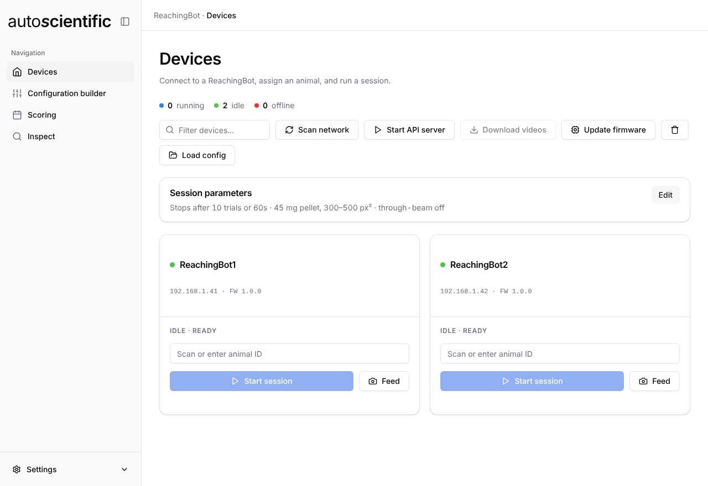

# ReachingBot app

The ReachingBot app is the current desktop application for running reaching
tasks on a fleet of ReachingBots, scoring the videos and reading the results.
It replaces the [ReachingBot Device Manager](../rbdm/getting-started.md).

<figure markdown>

<figcaption>The Devices view — where the app opens.</figcaption>
</figure>

It is a single window with four views:

| View | What it does |
| --- | --- |
| [Devices](devices.md) | The fleet: connect, tune session parameters, run and stop sessions, preview the camera, download videos, update firmware, serve the motor API |
| [Configuration builder](configuration-builder.md) | Build the experiment YAML: name the study, set device login, scan for and add ReachingBots, add animals |
| [Scoring](scoring.md) | Predict the outcome of every trial video into the session's results CSV |
| [Inspect](inspect.md) | Read the results CSVs back as hit/miss totals and a trial table |

## What is different from Device Manager

- **Per-device settings are editable.** Motor type, shooting mode, camera FPS,
  camera view and the pellet-detection ROI can be changed per device from its
  row in the Configuration builder, at any point. Device Manager hardcoded most
  of these.
- **Sessions stream live.** Device output is forwarded to the app as it
  happens, with trial progress and elapsed time on the device card, rather than
  being polled.
- **Scoring is built in.** The [Scoring](scoring.md) view gives the same
  predictions as Device Manager without its machine-learning stack — see
  [Scoring](#scoring) below.
- **Same config files.** Both apps read and write the same experiment YAML, so
  a config made in one opens in the other. See
  [Experiment config file](../reference/config-file.md).
- **Linux is supported**, alongside macOS and Windows.

[Moving from Device Manager](migrating.md) covers this in more detail.

## Scoring

The app scores videos itself, in the [Scoring](scoring.md) view, and gives
**identical** results to Device Manager — same labels, same keypoints, same
confidences, on the same reference set.

It does this without Device Manager's machine-learning stack (`torch`,
`ultralytics`, `scikit-learn`, `pandas` and OpenCV), which would have added
gigabytes to every installer. A handful of options did not come across — the
p-value setting, trajectory CSVs, the labelled-video export, and custom pose
models from the config. [Scoring](scoring.md#differences-from-device-managers-scoring)
lists them.

## Getting started

1. [Hardware setup and assembly](../hardware/setup.md)
2. [Device drivers](../hardware/drivers.md)
3. [Install the app](install.md)
4. [Build a configuration](configuration-builder.md)
5. [Run a session](devices.md)
6. [Score the videos](scoring.md) and [read the results](inspect.md)
