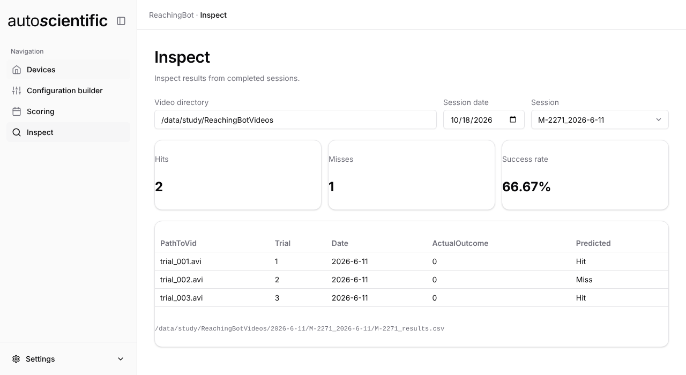

# Inspect

The **Inspect** view reads the results of sessions you have already
[downloaded](devices.md#download-videos). It only reads local files — it does
not touch the devices, and it does not score anything.

<figure markdown>

<figcaption>A scored session: totals across the top, then the results CSV as it appears on disk, with its path underneath.</figcaption>
</figure>

## Picking a session

| Field | Notes |
| --- | --- |
| **Video directory** | Filled in from the loaded config, or type a path in |
| **Session date** | Defaults to today |
| **Session** | The session folders found under that date. A folder with nothing to show is listed as `(no results)` |

Session folders follow the layout **Download videos** creates:
`{video directory}/{date}/{animal}_{date}`.

## What it shows

For a session with a results CSV:

- **Hits**, **Misses** and **Success rate** across the session
- The full CSV as a table, with the columns as they appear in the file
- The path of the CSV the numbers came from

Hits and misses are counted from the CSV's **Predicted** column, and the
success rate is hits ÷ (hits + misses), as a percentage.

## Where results come from

Inspect only reads. The `Predicted` column it counts is written by the
[Scoring](scoring.md) view.

So a freshly downloaded session shows **This session has no results CSV yet**
until it has been scored. Score it in [Scoring](scoring.md), then reopen it
here. A session scored in
[Device Manager](../rbdm/outcome-classification.md) reads the same way — both
write the same CSV into the same session folder.

See [Outcome classification](../rbdm/outcome-classification.md) for what the
outcomes mean.
