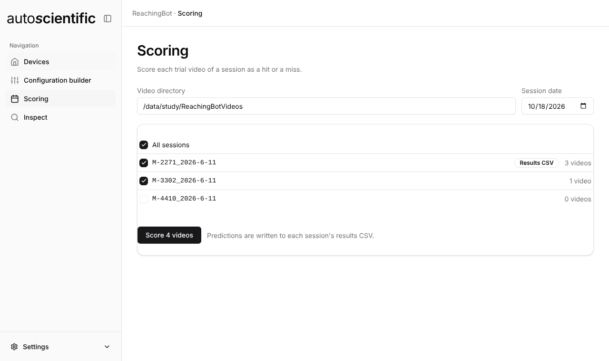
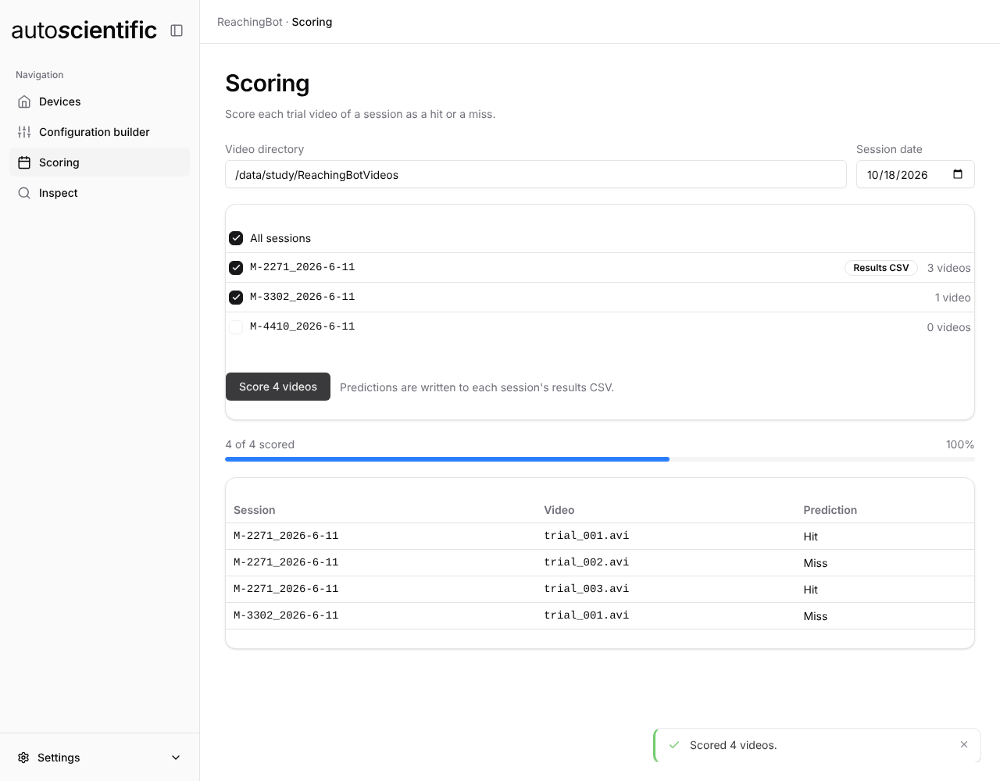

# Scoring

The **Scoring** view predicts the outcome of every trial video in the sessions
you choose, and writes those predictions into each session's results CSV — the
same CSV the [Inspect](inspect.md) view reads.

Scoring runs entirely inside the app. You do not need Device Manager for it.

<figure markdown>

<figcaption>The sessions found for a date. Folders that already hold a results CSV are marked; a folder with no videos cannot be ticked.</figcaption>
</figure>

## Choosing what to score

| Field | Notes |
| --- | --- |
| **Video directory** | Filled in from the loaded config, or type a path in |
| **Session date** | Defaults to today |

The session folders found under that date are listed with their video counts.
Folders with videos start ticked; **All sessions** toggles the lot. A folder
with no videos cannot be selected, and one that already has a results CSV is
badged **Results CSV** — it is still scorable, and scoring it fills in the
`Predicted` column without disturbing the other columns.

**Score _n_ videos** starts the batch. The count is the total across every
ticked session, so you know the size of the job before it begins.

## While it runs

Progress is shown as a count and a bar, with a row appended per video as its
prediction comes back.

<figure markdown>

<figcaption>A finished batch. Each row is one video and the outcome predicted for it.</figcaption>
</figure>

**Stop** finishes the video in flight and keeps everything already scored —
nothing is rolled back, so a stopped batch can be resumed by scoring the same
sessions again.

## What gets written

A session folder without a results CSV gets one, named `{folder}_results.csv`,
listing the folder's `.avi` files by trial. For a folder that already has a CSV,
the existing rows are kept.

Either way the prediction goes in the **`Predicted`** column, and every other
column — including a hand-filled `ActualOutcome` — is left alone.

| Prediction | Meaning |
| --- | --- |
| `Hit` | The animal took the pellet and ate it, without dropping it |
| `Miss` | The pellet was displaced but knocked away or dropped |
| `PelletNotTaken` | The video was recorded with the pellet still on the pedestal |
| `PelletNotPresentInVideo` | No pellet was present at the start of the video |
| `Error` | The video could not be scored |

See [Outcome classification](../rbdm/outcome-classification.md) for what the
first four mean in practice and how to set the rig up for the best accuracy —
that page describes the same classifier.

## Results identical to Device Manager

This is a reimplementation of Device Manager's scoring, not a new model, and it
is a deliberate match rather than an approximation. On the 270 labelled
reference videos and the 10 local test videos it produces identical labels,
keypoints and confidences to the original, and the same 0.807 accuracy against
the manual labels.

It achieves that without the original's machine-learning stack — `torch`,
`ultralytics`, `scikit-learn`, `pandas` and OpenCV — which would have added
gigabytes to every installer. The pose model is the same one Device Manager
ships.

Results also match **across platforms**. Video decoding otherwise differs by
CPU, so the scorer does its colour conversion in software and decodes without
CPU-specific optimisations; the test suite checks decoded pixels against known
hashes on macOS, Linux and Windows on every release.

## Differences from Device Manager's scoring

Deliberately not carried over:

- **The p-value setting** — fixed at `0.95`, which was Device Manager's batch
  default. On the reference set, `0.9` changed no prediction.
- **Per-video `_trajectory.csv`** files.
- **The labelled-video export** — Device Manager's "create a labelled video"
  option, used to check feature tracking by eye.
- **A custom pose-estimation model from the config.** The `PoseEstimationModel`
  key in an [experiment config](../reference/config-file.md) is read by Device
  Manager only; this app always uses its built-in model.

If you need any of those, score in
[Device Manager](../rbdm/outcome-classification.md) instead. Both write to the
same session folders, so you can mix the two.

!!! note "Memory"
    As in Device Manager, a video's frames are all held in memory while it is
    scored — roughly 275 MB for a 600-frame video.

## Next

- [Inspect](inspect.md) — read the hit/miss totals back
- [Devices](devices.md) — download more sessions to score
