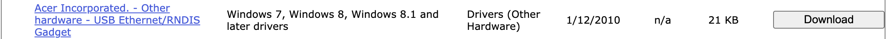

# Device drivers

Before either application can recognise your devices, you will first need to change the device drivers. You will only need to do this once for any given PC you chose to use with your devices. You will also only need to do this for one ReachingBot, not each one.

!!! note
    This step is the same whether you go on to use the [ReachingBot app](../app/index.md) or the legacy [ReachingBot Device Manager](../rbdm/getting-started.md). The video below was recorded with Device Manager, but the driver steps are identical.

For a visual demonstration on how to do this, watch [this YouTube video](https://www.youtube.com/watch?v=XaTmG708Mss&t=440s) from the 7:20 minute mark.

  <iframe src="https://www.youtube.com/embed/XaTmG708Mss?start=440" title="Driver setup walkthrough (starts at 7:20)" allow="accelerometer; autoplay; clipboard-write; encrypted-media; gyroscope; picture-in-picture; web-share" allowfullscreen></iframe>

1. **Download the correct drivers**

    You can do this by navigating to [this](https://www.catalog.update.microsoft.com/Search.aspx?q=USB+RNDIS+Gadget) page and downloading the driver pictured in the below screenshot:

    

    Download and unpack its contents in a known location on your PC.

2. **Navigate to the Device Manager on your PC and find where the ReachingBot is connected**

    It should be listed as a COM port, i.e. **COM3**

3. **Right click this device and choose “Update driver”** under advanced settings. It will give you the option to either locate the driver automatically over the internet, or manually.

    Chose manually, and navigate to the folder where you previously downloaded the driver.

This will now update the drivers for the ReachingBots and you will be able to connect to them from the ReachingBot software.
