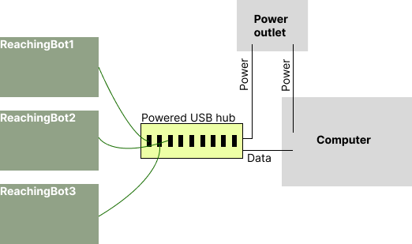
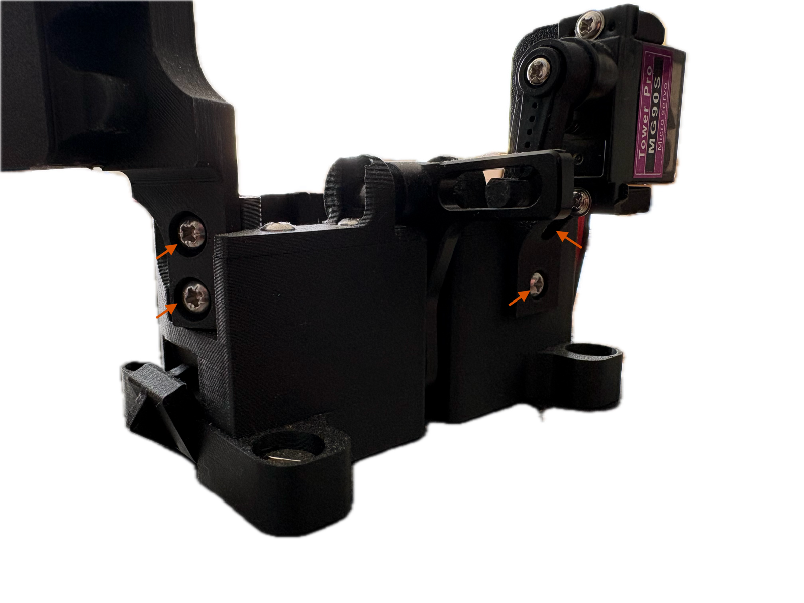

# Hardware setup and assembly

This page applies to **both** applications — the ReachingBot app and the legacy
ReachingBot Device Manager drive the same hardware over the same connection.

Once the hardware is assembled and the [device drivers](drivers.md) are installed,
pick the software you want to run:

- [ReachingBot app](../app/index.md) — the current desktop app
- [ReachingBot Device Manager](../rbdm/getting-started.md) — the legacy app, still required for video scoring

## Connection layout

ReachingBots are connected to your PC via the supplied powered USB hub. Connect each ReachingBot to one of the 7 USB ports on the powered hub that are blue. These ports can supply power to the devices and also allow your PC to communicate with them too. The bottom most three can only supply power so should not be used.

You can also connect your ReachingBot directly to your PC using the supplied USB A - USB C cable , but, be mindful that your PC may not be able to supply its required power, and lead to unstable behaviour. For this reason, it is recommended that the supplied powered USB hub is used.

## Before you begin

Your ReachingBot may arrive disassembled for safe travel. Please screw together the components indicated by the red arrows in the image above before continuing.

## Chamber assembly

Chambers are made from clear acrylic panels that assemble together using the supplied M3 x 20 mm screws and square nuts. Use [this video](https://www.youtube.com/watch?v=szwCmlw77bg) as a visual guide on how to assemble these chambers. In order to increase the contrast between the pellets and the background from with the camera frame, a dark backdrop is also supplied, which can be inserted into the front panel.

  <iframe src="https://www.youtube.com/embed/szwCmlw77bg" title="Chamber assembly" allow="accelerometer; autoplay; clipboard-write; encrypted-media; gyroscope; picture-in-picture; web-share" allowfullscreen></iframe>

The chamber remains in a fixed position relative to the dispensing unit. The dispensing unit can be moved via the guides within the aluminium base and fixed together with the clamps.

Note, when the dispenser is positioned in the “shaping” position, i.e. as close to the front panel of the chamber as possible, the backdrop will need to be positioned within the chamber. This can be re-positioned to the outside of the chamber once the animal learns to grasp for pellets with the dispenser in its furthest position if the user wishes to do so.

## Next

Install the [device drivers](drivers.md) — you only need to do this once per PC.
