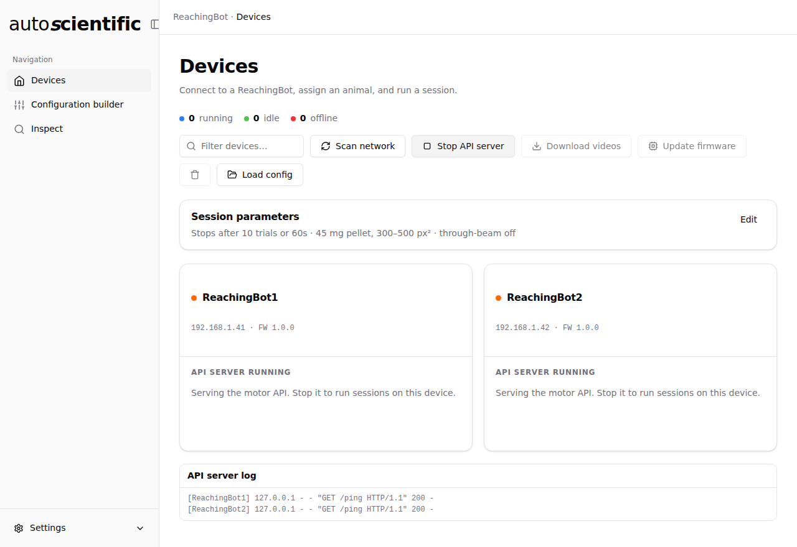

# ReachingBot API

The ReachingBot API lets you drive a ReachingBot directly from your own scripts. It's an HTTP server that runs on the device and exposes the same hardware actions the desktop applications use internally — dispensing pellets, returning the servo to its home position, and checking whether a pellet is currently on the pedestal.

The server is part of the device firmware, so the endpoints below are identical whichever application you start it from — the [ReachingBot app](../app/index.md) or the legacy [Device Manager](../rbdm/getting-started.md). Only the way you start it differs.

Use it when you want to:

- Trigger pellet dispensing from a Python notebook or another piece of software
- Build a custom session controller that doesn't rely on the desktop app
- Probe pellet detection results for ad-hoc analysis

## Starting the server

You start and stop the API server from the desktop application — there's no need to access the ReachingBot directly.

=== "ReachingBot app"

    1. Open the [Devices](../app/devices.md) view and connect to your devices as
       you normally would.
    2. Click **Start API server** in the toolbar. It starts on **every**
       connected device, and an **API server log** panel appears showing each
       request as it arrives.
    3. To shut the servers down, click **Stop API server**.

    A device serving the API reads **API server running** on its card and cannot
    run a session until the server is stopped.

    <figure markdown>
    
    <figcaption>Both devices serving the API. The log below the fleet shows each request as it arrives, tagged with the device that answered it.</figcaption>
    </figure>

=== "Device Manager (legacy)"

    1. Open the **Devices** tab in ReachingBot Device Manager and connect to your devices as you normally would.
    2. Click **Start API Server**. The button changes to **Stop API Server** while the server is running, and an output panel appears below showing each request as it arrives.
    3. To shut the server down, click **Stop API Server**.

While the server is running, your PC can reach it on port `8001` of each connected device, at `http://<reachingbot-host>:8001`. To explore the endpoints interactively, open the Swagger UI in a browser:

```
http://<reachingbot-host>:8001/apidocs
```

## Endpoints

All responses are JSON. On success the status code is `200` and the body contains `"status": "ok"`. On a hardware error the status code is `500` and the body contains `"status": "error"` and a `detail` string.

### Dispense a pellet

`POST /motor/get_pellet`

Moves the servo through its dispensing cycle.

```bash
curl -X POST http://<reachingbot-host>:8001/motor/get_pellet
```

```json
{ "status": "ok", "action": "get_pellet" }
```

### Return the servo home (fast)

`POST /motor/go_home`

Returns the servo to its home position immediately.

```bash
curl -X POST http://<reachingbot-host>:8001/motor/go_home
```

```json
{ "status": "ok", "action": "go_home" }
```

### Return the servo home (slow)

`POST /motor/go_home_slowly`

Returns the servo to its home position over multiple steps. Useful when you need a gentler return — for example, to avoid flicking a pellet off the pedestal.

```bash
curl -X POST http://<reachingbot-host>:8001/motor/go_home_slowly
```

```json
{ "status": "ok", "action": "go_home_slowly" }
```

### Stop the servo

`POST /motor/stop`

Disengages the servo so it stops actively holding position.

```bash
curl -X POST http://<reachingbot-host>:8001/motor/stop
```

```json
{ "status": "ok", "action": "stop" }
```

### Check for a pellet

`GET /pellet/detected`

Captures a single camera frame and runs blob detection on it. Returns whether a pellet was found and, if so, where it is in the frame.

```bash
curl http://<reachingbot-host>:8001/pellet/detected
```

When a pellet is present:

```json
{
  "status": "ok",
  "dispensed": true,
  "pellet": {
    "x": 312.4,
    "y": 248.1,
    "size": 387.0,
    "timestamp": 1715000000.123
  }
}
```

When no pellet is detected:

```json
{ "status": "ok", "dispensed": false }
```

The `x` and `y` coordinates are in pixels in the full camera frame, `size` is the blob area in pixels, and `timestamp` is the Unix timestamp when the frame was captured.

## Defaults

For reference, these are the values the API server uses for the servo, camera, and pellet detection. They match the shipped ReachingBot configuration and you don't need to set them yourself. The pulse-width limits come from the device's `motor_type` in the [experiment config](config-file.md); the rest are firmware defaults.

| Setting | Value | Description |
| --- | --- | --- |
| Port | `8001` | The port the server listens on |
| Servo pulse width | `0.8`–`2.1` ms | Minimum and maximum pulse width, for the default `MG996R` motor. An `MG90S` device uses `0.9`–`2.1` ms |
| Servo slow-return steps | `80` | Number of intermediate steps for `go_home_slowly` |
| Servo step interval | `0.025` s | Time between slow-return steps |
| Camera resolution | `512 × 320` | Frame size in pixels |
| Camera frame rate | `15` fps | Frames per second |
| Pellet blob area | `300`–`500` px | Minimum and maximum area for pellet detection |
| Detection ROI (x) | `0.60`–`0.875` | Left/right edges as fractions of frame width |
| Detection ROI (y) | `0.61`–`0.98` | Top/bottom edges as fractions of frame height |
